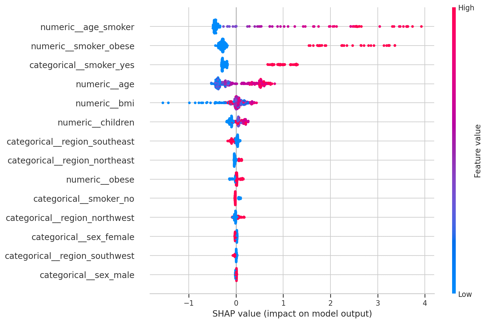

# Medical Insurance High-Cost Prediction | End-to-End Machine Learning

[](https://github.com/jeyhunaliyevv/medical-insurance-cost-risk-prediction/actions/workflows/tests.yml)

Predict whether a row from the public **Medical Cost Personal Dataset** exceeds an **illustrative $20,000 recorded-charge threshold**. This portfolio case study combines data-quality checks, exploratory analysis, leakage-aware preprocessing, training-only model selection, holdout evaluation, 20-split stability diagnostics and SHAP explanations. **It does not predict future claims, premiums or individual treatment needs.**

**Start here:** [Full analysis notebook](notebooks/01_full_analysis.ipynb) (60 cells, reproducible plots, results and business discussion) · [Prediction demo](notebooks/02_model_demo.ipynb) · [Python implementation](src/)

## Key findings

- **Costs are concentrated:** **273 / 1,337 records (20.4%)** have charges ≥ $20,000 and account for **52.3% of total charges**. The mean charge for those rows is **$33,985**, compared with **$7,966** for the remainder.
- **Smoking status is strongly associated with charges:** observed median charges are **$34,456** for smokers versus **$7,346** for non-smokers. **77.7%** of high-cost records are smokers; all **145** smoking records with BMI ≥ 30 meet the illustrative high-cost label. These are descriptive associations, **not causal claims**.
- **Performance is sensitive to the split:** the selected CatBoost classifier has ROC-AUC **0.9475** on one fixed holdout, but **0.9058** averaged across 20 other stratified holdouts. At a fixed 0.5 prediction threshold, repeated-split mean recall is **0.7664**. The single split is not a representative performance guarantee.
- **Model choice is not a proven win:** Logistic Regression, XGBoost and CatBoost have similar training-CV ROC-AUC. CatBoost is selected by the **predefined training-only CV rule**, not by its holdout result.


## Model evaluation

- **Dataset:** 1,338 original observations; **one exact duplicate removed before EDA, splitting and CV**, giving **1,337 unique rows**. No identifier exists to confirm whether this duplicate was a distinct real person; the choice is documented for leakage-safe evaluation.
- **Target:** `charges >= $20,000` (fixed, round-number teaching cutoff, about the 80th percentile). `charges` is **never** used as an input feature.
- **Input features:** age, BMI, children, sex, smoker status, region; deterministic interaction features `obese`, `smoker_obese`, `age_smoker`.
- **Selection:** stratified 80/20 split (42), training-only 5-fold CV; preprocessing fitted separately inside each fold.
- **Evaluation:** fixed 0.5 classification threshold; the untouched holdout is not used for selection or tuning.

| Model | Training CV ROC-AUC, mean ± SD | Holdout ROC-AUC | Holdout PR-AUC | Precision | Recall |
| --- | ---: | ---: | ---: | ---: | ---: |
| Logistic Regression | 0.8878 ± 0.0523 | 0.9402 | 0.9142 | 1.0000 | 0.8545 |
| XGBoost | 0.8785 ± 0.0491 | 0.9472 | 0.9270 | 1.0000 | 0.8545 |
| **CatBoost (selected)** | **0.8914 ± 0.0505** | **0.9475** | **0.9231** | **1.0000** | **0.8545** |

Single-split precision of 1.00 is based on a small holdout (**268 rows**) and does **not** establish perfect precision in practice. Full computed metrics including Brier scores: [`reports/metrics.json`](reports/metrics.json).

### 20-split sensitivity (CatBoost)

CatBoost is refitted on 20 additional stratified 80/20 splits (seeds 100–119). These **overlap**, do **not** rerun model selection and are **not independent confidence intervals or external validation**.

| Metric | Mean ± SD | Min–max |
| --- | ---: | ---: |
| ROC-AUC | 0.9058 ± 0.0272 | 0.8414–0.9589 |
| Precision | 0.9841 ± 0.0235 | 0.9091–1.0000 |
| Recall | 0.7664 ± 0.0538 | 0.6545–0.8545 |
| F1 | 0.8606 ± 0.0363 | 0.7912–0.9126 |


## Explainability and error analysis

SHAP values visualise the influence of transformed model inputs **on this fitted classifier**, not why people incur charges. Smoking-related and interaction features are prominent, but engineered variables are correlated, so attributing causal importance to each one is inappropriate.



See the notebook for the holdout confusion matrix, precision–recall curve, subgroup descriptive summaries, and the exact number of false negatives and false positives. The available features omit diagnoses, treatment history and other potentially meaningful factors.

## Reproduce locally

**Python 3.11** is used in GitHub Actions. On first run, the public source dataset downloads automatically to `data/insurance.csv` and its content is checked against a pinned SHA-256 hash.

```bash
python -m pip install -r requirements.txt
python -m pytest -q
python -m src.train
python -m src.stability
python -m src.predict
jupyter notebook
```

Open [`notebooks/01_full_analysis.ipynb`](notebooks/01_full_analysis.ipynb) and use **Restart & Run All** from the repository root or `notebooks/`. Training writes metrics and plots to `reports/`; its model artifact is saved locally under `models/` and intentionally excluded from Git. The notebook has already been executed and its outputs saved for GitHub readers.

### Repository layout

```text
notebooks/      Full analysis and prediction demo, with saved outputs
src/data.py     Download + SHA-256 verification
src/pipeline.py Validation, exact-dedup cleaning, feature engineering, preprocessing
src/train.py    CV, final evaluation, model saving and SHAP
src/stability.py Repeated-holdout sensitivity analysis
tests/          Unit tests including duplicate-removal regression test
reports/        Recomputed JSON/CSV metrics and 13 analysis figures
.github/        CI test workflow
```

## Data, limitations and responsible use

- Source: public [Medical Cost Personal Dataset](https://github.com/stedy/Machine-Learning-with-R-datasets/blob/master/insurance.csv); **1,338 source rows**; 1 exact duplicate removed in memory (original downloaded file is unchanged). The CSV is **not redistributed in this repository**; its redistribution rights were not verified. See [`data/README.md`](data/README.md).
- The data's collection method and representativeness are not documented, and observations are not longitudinal. This is not a prospective, clinically validated or production actuarial model.
- Sensitive variables (`sex`, `region`) are included for an educational comparison. Real-world deployment needs group-level fairness testing, calibration, legal/domain review, representative data and continuous monitoring.
- The project does **not** claim savings, reduced claims, ROI or the ability to make insurance eligibility/pricing or healthcare decisions. Such decisions should never be automated using this notebook.
- Model selection CV differences are small; the selected classifier is not demonstrably superior to the simpler baseline based on these splits alone.
- The local `.joblib` file uses Python pickle serialization; load **only** artifacts produced by trusted code.

## License

Code and documentation: [MIT License](LICENSE). This license does not apply to the separately sourced CSV.
