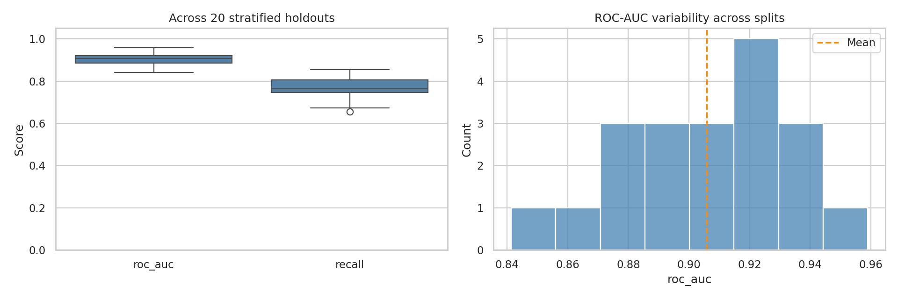

# Medical Insurance High-Cost Prediction · End-to-End ML

[](https://github.com/jeyhunaliyevv/medical-insurance-cost-risk-prediction/actions/workflows/tests.yml)

A portfolio project on a public insurance dataset: predict which policyholders have annual medical charges of **$20,000 or more** (about 20% of the 1,338 records). It compares Logistic Regression, XGBoost and CatBoost, tests how stable the results are across different train/test splits, analyses the model's errors and explains predictions with SHAP. It is a modelling exercise on a teaching dataset, not claims adjudication or individual pricing.

**Start here:** [`notebooks/01_full_analysis.ipynb`](notebooks/01_full_analysis.ipynb) is a complete walkthrough with 13 charts and a written finding for each step. The same logic is packaged as tested modules in [`src/`](src).

## Key findings

- **Cost is concentrated.** 20.4% of records (charges of $20,000 or more) generate **52.3%** of all charges. Their average charge is $33,985 versus $7,960 for the rest.
- **Smoking drives the risk.** Median charges are $34,456 for smokers and $7,345 for non-smokers; 77.7% of high-cost records are smokers, and all 145 smokers with BMI of 30 or more are high-cost. Non-smokers are rarely high-cost (about 6%), whether or not they are obese.
- **SHAP agrees.** The strongest model inputs are `age_smoker`, `smoker_obese` and `smoker_yes`; region and sex contribute very little.
- **Realistic performance.** ROC-AUC is about 0.88 in cross-validation and about 0.91 over 20 random holdouts; recall at the 0.5 cutoff is about 0.76. The single split used for the plots (ROC-AUC 0.953) is on the favourable side.
- **The three models are practically tied,** so the choice of CatBoost is not a strong claim.
- **What it misses.** In the single plotted split, all 8 missed high-cost records are non-smokers; their high cost is probably explained by information that is not in the data.


## Results

Model selection uses training-only 5-fold cross-validation. The 20% holdout is evaluated once, at a fixed 0.5 probability cutoff.

| Model | Training CV ROC-AUC | Holdout ROC-AUC | Holdout precision | Holdout recall |
| --- | ---: | ---: | ---: | ---: |
| Logistic Regression | 0.881 ± 0.046 | 0.943 | 0.98 | 0.85 |
| XGBoost | 0.876 ± 0.040 | 0.947 | 1.00 | 0.85 |
| **CatBoost (selected)** | 0.885 ± 0.032 | 0.953 | 1.00 | 0.85 |

**This single split is optimistic.** To see how sensitive it is, the preselected CatBoost model was refitted on 20 other stratified 80/20 splits (seeds 100-119; the model choice is not repeated, and the test sets overlap, so this is descriptive and not a confidence interval):

| Metric over 20 splits | Mean ± SD (min-max) |
| --- | ---: |
| ROC-AUC | 0.907 ± 0.026 (0.845-0.954) |
| Precision | 0.981 ± 0.022 (0.909-1.000) |
| Recall | 0.764 ± 0.052 (0.654-0.855) |
| F1 | 0.858 ± 0.035 (0.791-0.913) |

Do not quote the 0.953 ROC-AUC or the 85% recall of the single split as typical; use about 0.9 and about 0.76. Per-split values: [`reports/stability_splits.csv`](reports/stability_splits.csv).




## Business context

Costs concentrate in a small group (see key findings), so finding that group early could support portfolio and reserve planning, risk monitoring and voluntary preventive-care outreach for further human review. **This project has not measured savings, avoided claims or ROI**; that would need real claims data and a pilot with a control group. A score must not be used on its own to deny coverage, set an individual's premium or make healthcare decisions. Details are in section 11 of the notebook.

## Method

1. **Target:** `charges >= $20,000`, a fixed round-number illustrative cutoff (about the 80th percentile of this dataset). `charges` is never used as a feature.
2. **Features:** age, sex, BMI, children, smoker, region plus `obese` (BMI ≥ 30), `smoker_obese` and `age_smoker`. Input validation rejects impossible or missing values.
3. **Validation:** stratified 80/20 holdout; 5-fold cross-validation on the training part only; scaling and encoding are fitted inside the folds.
4. **Selection:** highest mean training-CV ROC-AUC among Logistic Regression, XGBoost and CatBoost.
5. **Evaluation:** ROC-AUC, PR-AUC, Brier score, precision, recall and F1 on the holdout, then the 20-split stability check and an error analysis.
6. **Explanation:** SHAP on the selected tree model; it describes model behaviour, not causes.

## Run it

CI runs on Python 3.11; the project was also run on Python 3.12. An internet connection is needed on the first run, because the public CSV is downloaded automatically and checked against a pinned SHA-256.

```bash
python -m pip install -r requirements.txt
python -m pytest -q          # unit tests (no dataset needed)
python -m src.train          # trains, writes reports/metrics.json and figures, saves a local model file
python -m src.stability      # 20-split stability diagnostic
python -m src.predict        # example prediction from the local model
```

For the notebook, start Jupyter in the repository root or in `notebooks/` and open `notebooks/01_full_analysis.ipynb` (**Kernel → Restart & Run All**). The saved notebook already contains its outputs, so it can be read on GitHub without running it.

```
notebooks/01_full_analysis.ipynb   full walkthrough with charts and findings
src/data.py                        dataset download and checksum
src/pipeline.py                    validation, target, features, preprocessing
src/train.py                       cross-validation, holdout evaluation, SHAP, artifacts
src/stability.py                   20-split stability diagnostic
src/predict.py                     predict from the local model
tests/                             pytest suite (also run by GitHub Actions)
reports/                           metrics, stability results and figures
```

`models/best_model.joblib` is generated locally and git-ignored. `joblib` uses pickle, so only load model files you created yourself.

## Data

The public *Medical Cost Personal Dataset* (1,338 rows) from [Machine-Learning-with-R-datasets](https://github.com/stedy/Machine-Learning-with-R-datasets/blob/master/insurance.csv). The CSV is **not stored in this repository** because its redistribution terms were not verified; the code downloads it on first use. See [`data/README.md`](data/README.md). No employer, client or confidential records are used.

## Limitations and ethics

This is a small teaching dataset whose generation process is not documented, so the results do not describe real insurance portfolios. The label is an illustrative cost cutoff, not a claim or payment outcome. Predictions based on demographic and lifestyle features raise fairness and compliance questions; any real use would need representative longitudinal data, calibration and bias checks, domain and legal review, and monitoring.

## License

Code and documentation: [MIT](LICENSE). The upstream CSV is not covered by this license and must be obtained under its own terms.
