# Medical Insurance High-Cost Prediction · End-to-End ML

[](https://github.com/jeyhunaliyevv/medical-insurance-cost-risk-prediction/actions/workflows/tests.yml)

A portfolio study of **whether example medical insurance charges exceed a predefined $20,000 threshold**, using three classification models and an explainability walkthrough. The objective is modeling and reproducible practice, not actual insurance claim adjudication or individualized pricing.

## Start here

- **Readable, complete notebook:** [`notebooks/01_full_analysis.ipynb`](notebooks/01_full_analysis.ipynb) — data, EDA, label design, leakage prevention, feature engineering, model selection, evaluation, explanations, demo.
- **Production-style modules:** [`src/pipeline.py`](src/pipeline.py), [`src/train.py`](src/train.py), [`src/predict.py`](src/predict.py).
- **Automated tests:** [`tests/test_pipeline.py`](tests/test_pipeline.py); CI workflow [`tests.yml`](.github/workflows/tests.yml).

## Data & provenance

Input is the **1,338-row medical insurance charges teaching dataset** (`age`, `sex`, `bmi`, `children`, `smoker`, `region`, `charges`). Original dataset project: https://github.com/stedy/Machine-Learning-with-R-datasets/blob/master/insurance.csv. This repository uses a separately obtained **public teaching dataset**. No employer, client, or confidential insurance records are included. The upstream dataset redistribution terms have not been verified, so **the CSV is intentionally not distributed in this repository**. Download it from the source and save it as `data/insurance.csv` before running. See [`data/README.md`](data/README.md).

## Leakage-aware methodology

1. Target: `charges >= 20000` USD, **fixed and illustrative**. Unlike a whole-dataset quantile-derived label, the cutoff is not computed from test records.
2. `charges` is excluded from features. Input validation rejects impossible or missing fields. Three engineered features: `obese`, `smoker_obese`, `age_smoker`.
3. Stratified 80/20 holdout and **5-fold training-only** cross-validation, with scaling and encoding fitted inside folds.
4. Compare Logistic Regression, XGBoost and CatBoost. Select using mean training-CV ROC-AUC.
5. Single holdout evaluation: ROC-AUC, PR-AUC, Brier, Precision, Recall, F1; use a predeclared 0.5 classification threshold.
6. SHAP (if a tree-based model wins) highlights model feature contributions, **not causal impact**.

## Run locally

Requires Python 3.11 or a compatible version. From the repository root:

```bash
python -m pip install -r requirements.txt
python -m pytest -q
python -m src.train
python -m src.predict
```

Training writes `reports/metrics.json`, a holdout ROC comparison, an optional SHAP figure, and a locally generated `models/best_model.joblib`. Treat `.joblib` files as executable pickle: **never load an untrusted copy**. Both the model and dataset are intentionally excluded from a default public GitHub commit. The analysis notebook detects the project source root when Jupyter is started in the repository root or `notebooks/` folder and gives a specific message if the separately downloaded CSV is missing. Open `notebooks/01_full_analysis.ipynb` and use **Kernel → Restart & Run All**. The pre-executed notebook also contains embedded outputs viewable directly on GitHub.

## Verified results and how to read them

**Selection:** CatBoost won by training-only 5-fold ROC-AUC. The single untouched 20% holdout is reported separately. The values are different from earlier experiments that used a percentile-derived target; the label here is consistently **charges ≥ $20,000**.

| Model | Training CV ROC-AUC (mean ± SD) | Holdout ROC-AUC | Holdout precision | Holdout recall |
| --- | ---: | ---: | ---: | ---: |
| Logistic Regression | 0.8808 ± 0.0465 | 0.9434 | 0.9792 | 0.8545 |
| XGBoost | 0.8761 ± 0.0401 | 0.9469 | 1.0000 | 0.8545 |
| **CatBoost (selected)** | **0.8854 ± 0.0323** | **0.9531** | **1.0000** | **0.8545** |

The **0.9531 holdout ROC-AUC is one split, not expected future accuracy**. ROC-AUC measures the ability to rank positive cases ahead of negative cases; it is not classification accuracy. Precision and recall use the fixed 0.50 probability cutoff. Results are on an illustrative dataset and cannot be generalized to actual insurer portfolios.

### Stability across 20 different train/test splits

To assess sensitivity to a single favorable split, we **refit the preselected CatBoost algorithm** on 20 stratified 80/20 partitions (seeds 100–119). This diagnostic **does not repeat algorithm selection** at each split. Repeated test partitions overlap, so these descriptive averages are *not independent external validation or confidence intervals*.

| Holdout metric across 20 splits | Mean | Standard deviation | Minimum–Maximum |
| --- | ---: | ---: | ---: |
| ROC-AUC | **0.9066** | 0.0262 | 0.8450–0.9535 |
| Precision | 0.9806 | 0.0225 | 0.9091–1.0000 |
| Recall | **0.7636** | 0.0524 | 0.6545–0.8545 |
| F1 | 0.8576 | 0.0351 | 0.7912–0.9126 |

Read the individual splits in [`reports/stability_splits.csv`](reports/stability_splits.csv), the summary in [`reports/stability_summary.json`](reports/stability_summary.json), and the reproducible analysis in [`src/stability.py`](src/stability.py). **Do not present 85.45% recall from the original split as the typical recall.** The across-split mean is about **76%**.


### Business evidence from the sample

At the fixed **$20,000** threshold, **273 of 1,338 records (20.4%) account for 52.3% of all recorded charges**. Their observed mean charge is **$33,985**, versus **$7,960** for the other records. This highlights cost concentration *within the sample*, potentially useful for a portfolio monitoring case study. These are **descriptive dataset findings, not measured savings, avoided claims, ROI, or a forecast of exact future expenses**.

### Visual results — generated by executable Notebook cells

**All plots below were generated from the public example CSV obtained from its upstream source.** Open [`01_full_analysis.ipynb`](notebooks/01_full_analysis.ipynb) on GitHub to see the corresponding Python code, **inline rendered results**, and business-oriented interpretation. EDA associations are observational, not causal.

**EDA 1 · Charge distribution and outliers.** Histogram and boxplot show the distribution and the predefined $20,000 threshold.

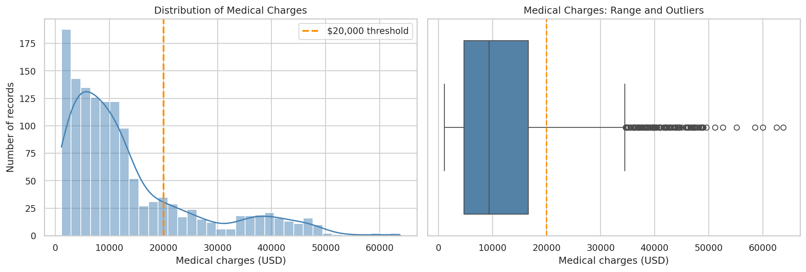

**EDA 2 · Smoking status.** Distribution and median medical charges by smoking-status group.

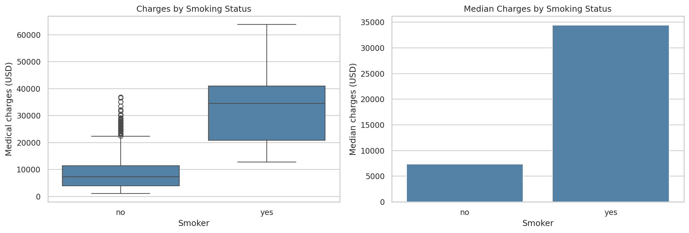

**EDA 3 · Age vs. charges.** Observed age–charge relationship, annotated by smoking group.

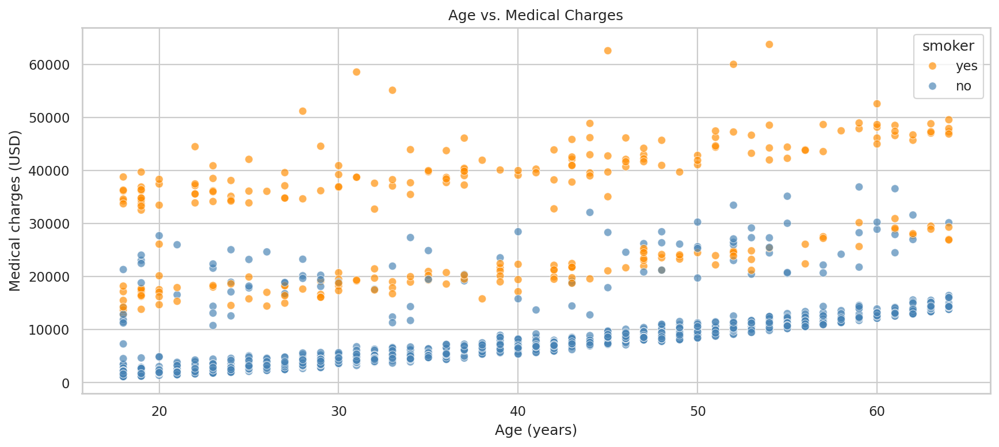

**EDA 4 · BMI vs. charges.** BMI–charge relationship and a descriptive BMI 30 reference.

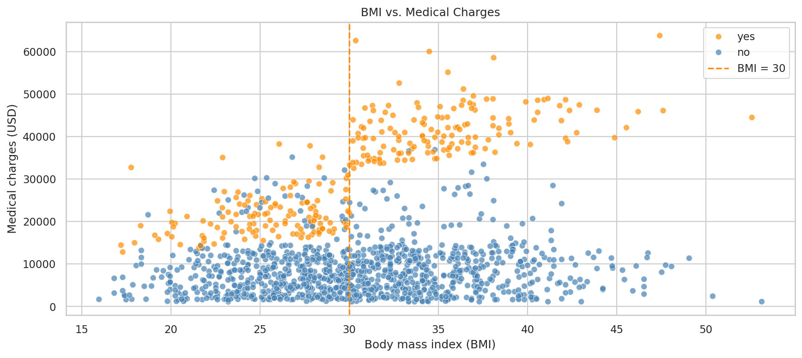

**EDA 5 · Region and children.** Group-level median charges by region and number of children.

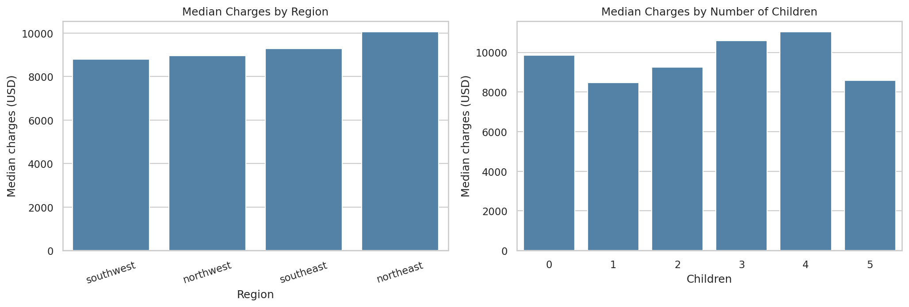

**EDA 6 · Class balance and high-cost segments.** Label prevalence and unadjusted high-cost rates by group.

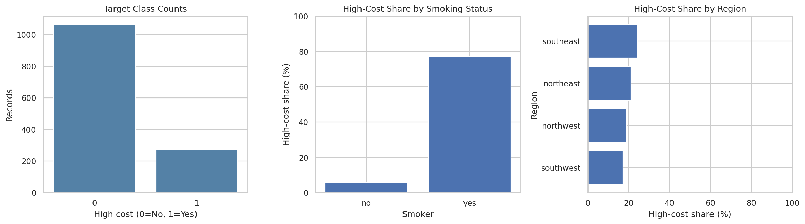

**EDA 7 · Numeric correlations.** Pearson correlation for numeric fields.

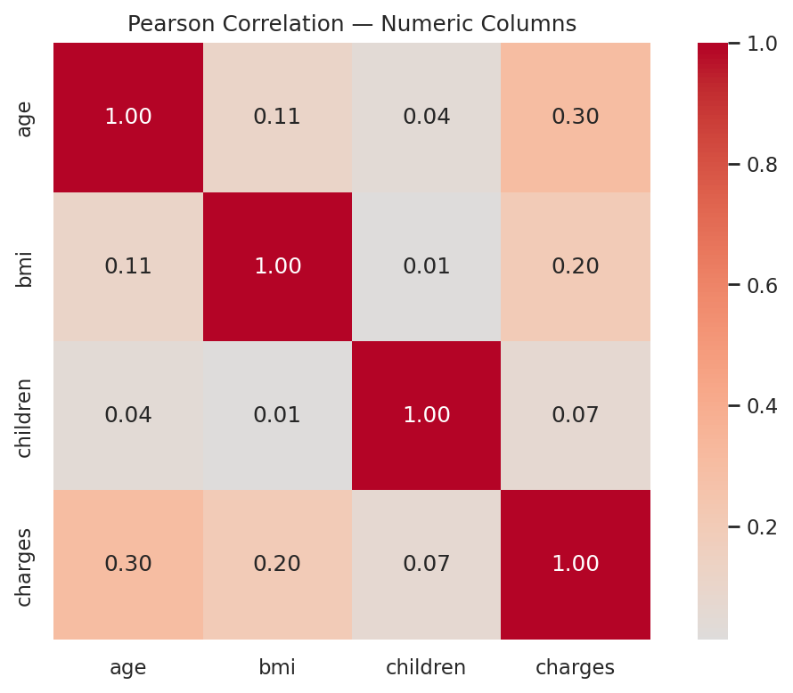

**Model selection · CV and holdout.** Model selected using training CV, with final holdout reported separately.

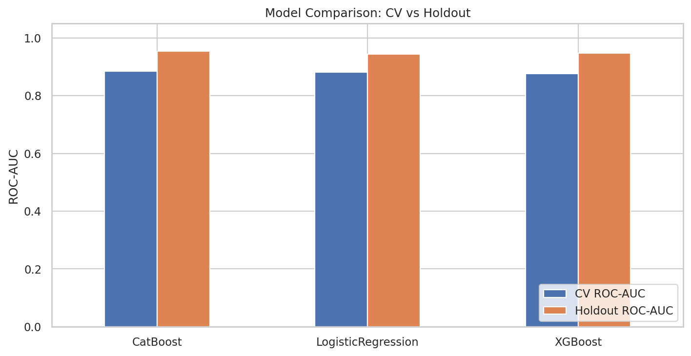

**Holdout ROC curves.** Ability to distinguish the classes over probability thresholds.

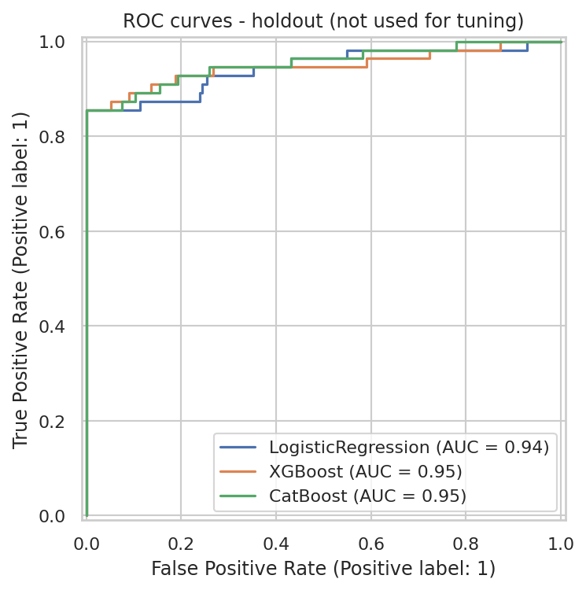

**Confusion matrix.** Classifications at the fixed 0.50 probability cutoff.

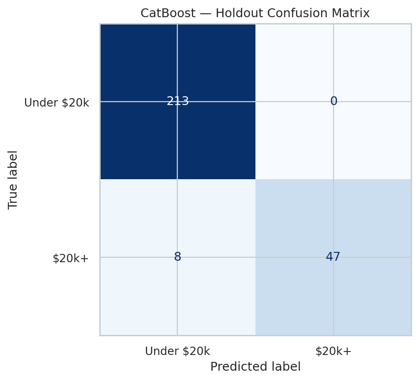

**Precision–Recall curve.** Precision/recall tradeoff for the positive high-cost class.

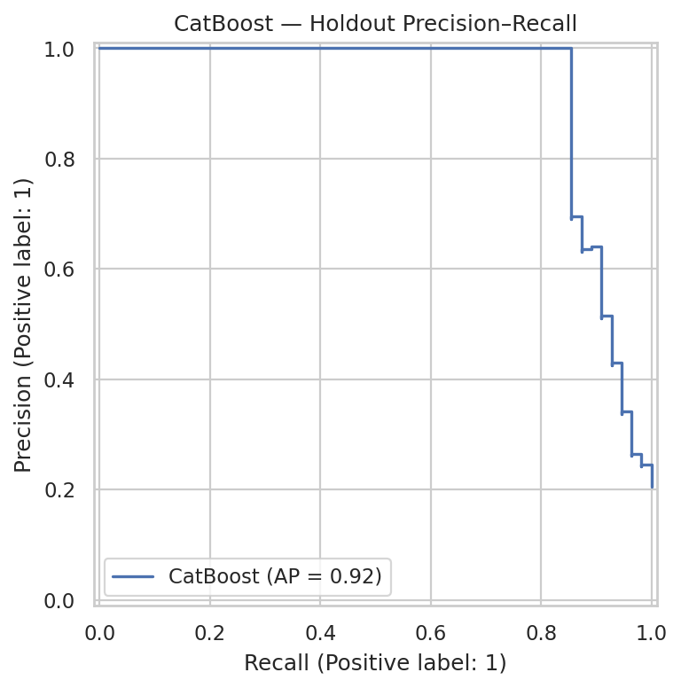

**SHAP feature contributions.** Model contributions for the selected tree model, not causal inference.


## Quality checks

`pytest` checks required columns, implausible values, engineered features, fixed threshold behavior, basic pipeline predictions, and CV execution. The GitHub Actions workflow runs these checks for new pushes and pull requests. Check the live GitHub Actions badge at the top of this README for the current CI result. The workflow tests code using synthetic test records and does not require the upstream dataset.

## Business Value & Decision-Making

**Business question:** Based on an individual's available characteristics, can an illustrative model flag records whose medical insurance-related charges are **$20,000 or more**? This is a *classification* problem: the model estimates a probability of exceeding that threshold, not an exact dollar amount, a future claim event, or a customer's premium.

**Potential users and decisions (hypothetical):**

| Stakeholder | How a validated risk score might help | What the score does *not* establish |
| --- | --- | --- |
| Portfolio / finance team | Summarize the share of potentially high-cost cases by segment to support scenario planning and reserve discussions | A precise dollar forecast or an actuarial reserve estimate |
| Care-management team | Prioritize *voluntary, supportive* preventive-care outreach for further review, subject to consent and appropriate clinical oversight | That outreach will reduce costs or that the model gives medical advice |
| Risk / analytics team | Monitor cost-risk patterns and investigate changes in portfolio mix | The cause of high charges or an approved underwriting decision |
| Insurance broker (where relevant) | Discuss aggregate portfolio insights and possible wellness initiatives with an insurer, subject to permissions | Claim-level predictions, insurer pricing authority, or access to restricted client information |

**Illustrative workflow:** (1) Validate data quality and lawful data access; (2) score a cohort; (3) group customers into *relative* predicted-risk bands for analysis; (4) review aggregate patterns with business, actuarial, compliance, and clinical stakeholders; (5) pilot an intervention separately and measure its incremental results. A score must **not** be used by itself to deny coverage, set an individual's premium, or make healthcare decisions.

**How business value would be measured:** For an approved pilot, measure targeting precision and calibration, outreach uptake, administrative costs, and changes in medical charges compared with a suitable control group. A basic *hypothetical* net-benefit framework is `avoided costs - program costs`; **this project has not measured avoided costs, ROI, savings, or incremental business impact**.

**Important scope limitation:** This is a small, cross-sectional **educational medical charges dataset** without claim dates, claim events, outcomes after intervention, policy premiums, or temporal validation. The $20,000 cutoff is an analytical example, not an industry-defined high-risk threshold. The sample is not sufficient for real-world insurance pricing, reserving, underwriting, or medical decision-making. Deployment would require representative longitudinal data, fairness and calibration checks, domain review, legal compliance, privacy safeguards, and monitoring.

## Limitations & ethics

This small teaching dataset has limited representativeness and unknown underlying generation details. Results are not insurance premium recommendations, medical advice, or evidence of causation. Risk predictions based on demographic and lifestyle features may raise bias, fairness, and compliance concerns. No real claim events or payment/default outcomes are recorded. Additional feature validation, fairness analysis, longitudinal evaluation, stakeholder review, and deployment controls would be required before any real-world application.

## Code license and data terms

The project's original code and documentation are licensed under [MIT](LICENSE). **The upstream medical insurance CSV is not covered by this license**, is not redistributed here, and must be obtained independently under its own terms. The project is an educational portfolio case study, not clinical or actuarial software.
